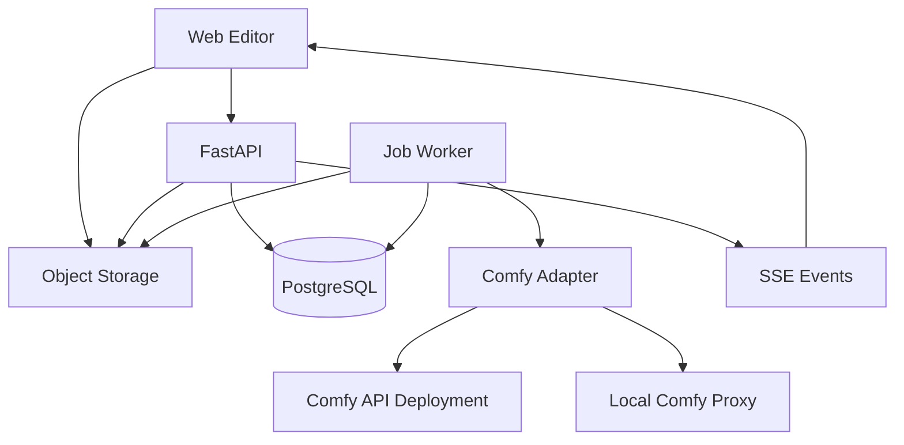

# Open Creative Apps — 공통 구현 스펙 v0.1

작성일: 2026-10-19 · 상태: 구현을 시작하기 위한 설계. 코드 구현·GPU 벤치마크·유료 API 호출은 아직 수행하지 않았다.

## 1. 결정과 가정

Product Lock, Camera Sketch, Pocket VFX를 서로 독립된 웹 앱으로 개발한다. 공통 UI primitive, 미디어 처리, 작업 관리, Comfy 어댑터는 공유한다. 이 문서는 세 개별 스펙에 공통으로 적용한다. 개별 스펙과 충돌하면 개별 스펙의 더 좁은 제한을 따른다.

| 항목 | 기본 결정 |
|---|---|
| 출시 목표 | 해커톤에서 실제 입력으로 재현 가능한 웹 데모, 코드와 워크플로 공개 |
| 형태 | 데스크톱 편집 우선, 모바일 업로드·간단 편집·결과 열람 지원 |
| UI 언어 | 영어 기본, 한국어 리소스 제공. 임의 프롬프트는 번역 없이도 입력 가능하되 영어 예시 제공 |
| 로그인 | 익명 HttpOnly 세션. OAuth·결제는 P1 이후 |
| 주 실행 경로 | Comfy Developer Platform의 Comfy API deployment에 배포한 workflow |
| 개발 경로 | self-hosted ComfyUI + comfy-api-proxy로 같은 SDK 사용 |
| 모델 방향 | 공개 가중치 모델을 직접 실행하는 profile을 기본으로 설계 |
| 코드 라이선스 | 신규 자체 코드 MIT. 외부 코드·모델·폰트·영상 소스 라이선스는 개별 유지 |
| 결과 공개 | 기본 비공개. 다운로드와 별개로 Share 동작을 해야 공개 링크 생성 |
| 시간·비용 | 아래 수치는 제품 제한/측정 목표이며 공급자 보장치나 실측값이 아님 |

공식 행사는 Developer Platform 사용, 공개 라이선스 및 설치 설명을 요구한다. Open Weights Only는 partner node/closed API를 배제한다. 실제 출품 자격과 복수 출품 규칙은 제출 폼의 최신 조건으로 확인한다. 앱 코드 MIT와 모델의 상업 이용 조건은 별개다. [S1]

## 2. 기술 스택

| 영역 | 선택 | 역할 |
|---|---|---|
| Web | Next.js App Router + React + TypeScript | 앱 셸, 프로젝트 라우트, 편집기 |
| 디자인 | Tailwind CSS + Radix primitives + Lucide | 토큰·폼·dialog·tooltip·아이콘 |
| 상태 | Zustand / TanStack Query | 편집 상태와 서버 작업 상태를 구분 |
| Canvas | react-konva, Camera Sketch는 Three.js 추가 | 마스크·포인트·경로 편집, 2.5D 미리보기 |
| Backend | Python 3.12 + FastAPI + Pydantic | 프로젝트/API/스키마/작업 관리 |
| DB | PostgreSQL + SQLAlchemy + Alembic | 영속 상태, revision, job lease, event |
| 작업 실행 | PostgreSQL lease 기반 Python worker | GPU 추론 요청·다운로드·인코딩 분리 |
| 미디어 | FFmpeg/ffprobe, Pillow, NumPy, OpenCV | 정규화, 합성, 썸네일, 품질 검사 |
| 추론 | comfy-sdk의 workflow/jobs/assets 클라이언트 | Comfy API v2 실행 |
| 저장 | S3 호환 객체 저장소. 로컬은 MinIO | 원본, 정규화본, 마스크, 결과 |
| 배포 | Web + API + CPU worker + Postgres + object store / GPU는 Comfy | HTTP 요청과 긴 영상 생성을 분리 |

작업용 Redis/Celery는 P0에 도입하지 않는다. DB가 대기열과 상태의 기준이다. CPU worker는 inference를 직접 수행하지 않고 Comfy에 제출한다. 브라우저에는 Comfy API key를 전달하지 않는다. 패키지 버전은 실제 첫 통합 성공 시 lockfile에 고정한다.

## 3. 아키텍처



브라우저에서 object store로 직접 업로드할 때는 서버가 소유자를 확인한 후 발급한 짧은 upload URL만 사용한다.

### 저장소 구조

| 경로 | 내용 |
|---|---|
| apps/studio | 세 도구(Camera Sketch, Product Lock, Pocket VFX)를 하나로 합친 Next.js 앱 (2026-10-26 통합; 이전에는 도구별 독립 앱) |
| packages/ui | Button, slider, upload, stage, timeline, job panel |
| packages/contracts | OpenAPI에서 생성한 TS type/client |
| services/api | FastAPI, DB migration, session, validation |
| services/worker | stage executor, lease, provider adapter, encoder |
| nodes/open_creative | 자체 Comfy custom node. 각 클래스는 개별 스펙에 정의 |
| workflows/{app} | API graph JSON, 편집용 workflow JSON, binding manifest |
| models | 모델 ID/revision/파일 sha256/라이선스 manifest. weight 미포함 |
| presets/{app} | 프롬프트, 효과, UI 설정의 버전별 preset |
| fixtures/{app} | 권리 확보한 작은 입력과 golden artifact |
| infra | Docker Compose, 환경 변수 예시, 배포 설명 |

독립 제출 시 각 앱 폴더와 필요한 shared package만 포함하는 export script를 제공한다. repo root 하나를 실행할 때는 APP_SLUG로 선택한다. 외부 모델 다운로드에는 gated model 승인 등이 필요할 수 있으며 credential은 사용자 환경으로 주입한다.

## 4. Comfy 통합 계약

### 4.1 확인한 API와 앱이 정의하는 API의 구분

Comfy의 공식 Python SDK는 `comfy-sdk`, import는 `from comfy_sdk import Comfy`이다. workflow 실행 경로와 모델 Router는 서로 다른 API 표면이다. 이 설계에서는 graph를 실행하는 workflow 경로만 기본 사용한다. `COMFY_BASE_URL`은 실제 배포 endpoint로 설정하고, 로컬 v2 proxy의 기본 주소는 `http://127.0.0.1:8189`다. 일반 ComfyUI의 8188에 v2 SDK를 바로 연결하지 않는다. [S2]

SDK의 정확한 async/event/cancel method는 설치한 버전의 type 및 OpenAPI에서 확인한다. 아래 adapter method는 우리 시스템이 구현하는 interface이며 공급자 SDK의 method 이름이 아니다.

```python
class WorkflowRunner:
    def capabilities(self) -> dict: ...
    def submit(self, graph_path, bindings, submission_key) -> str: ...
    def inspect(self, provider_job_id) -> dict: ...
    def events(self, provider_job_id, cursor=None): ...
    def collect(self, provider_job_id, target_dir) -> list: ...
    def cancel(self, provider_job_id) -> dict: ...
```

각 binding은 API graph의 node ID + input field에 대응한다. 런타임에서 이미지·prompt·seed·마스크·해상도·frame count만 치환하고 임의 graph 업로드는 허용하지 않는다. UI workflow JSON과 실행용 API JSON은 별도로 export한다. 입력 node ID를 문서에서 추정해 하드코딩하지 않고 실제 exported graph와 binding manifest를 함께 검증한다.

실행 순서: object store에서 원본 다운로드 → `client.assets.from_file(...)`로 asset handle 준비 → `client.workflows.from_file(...)` → `set_input(...)` → `client.submit(...)` → provider job ID 영속화 → status/event 수집 → output 다운로드 → 객체 저장소 복사 → 후처리. Python SDK 동기 호출은 API event loop가 아닌 별도 worker에서만 사용한다.

### 4.2 지원성 검증

새 build는 다음 smoke test를 통과해야 available로 노출한다.

1. 모든 모델·encoder·VAE·LoRA 파일과 sha256이 manifest에 존재.
2. 배포 build에 필요한 노드와 Python/system dependency 포함.
3. 작은 이미지·마스크·프레임 묶음을 업로드하고 실제 결과 수집 성공.
4. graph schema와 binding의 필드·값 범위 일치.
5. 1회 실행의 GPU 메모리, wall time, 출력 형식 기록.

Cloud의 기본 node 목록에 custom node가 있다는 가정을 하지 않는다. Comfy API deployment build에 자체 node를 넣는 것을 전제로 하며, 계정에서 빌드가 불가하면 local 경로로 개발하고 출품 전에 실제 Developer Platform 경로를 통합한다. 로컬 데모만으로 플랫폼 사용 조건을 충족했다고 표시하지 않는다.

### 4.3 재시도와 중복 생성

앱의 `Idempotency-Key`는 같은 session+endpoint+body hash에 대해 같은 앱 job을 돌려준다. 다른 body로 재사용하면 409다. 기본 보존 기간은 24시간. provider submission key는 앱 job+stage+attempt에서 결정하고 DB에 먼저 저장한다.

공식 SDK의 provider idempotency는 동일 key의 재전송에 기존 job을 반환하는 방식이 아니라 거절하는 방식이다. 따라서 POST 후 timeout이 났는데 provider ID를 모르면 새로운 key로 자동 재제출하지 않는다. `submission_unknown`으로 격리한다. ID를 안다면 기존 job을 조회한다. 확정적 validation failure와 전송 전 오류만 안전하게 재시도한다. [S2]

조회·다운로드는 jitter를 넣어 1/2/4/8초, 최대 30초 간격으로 재시도한다. 미디어 stage 재실행은 기존 산출물 hash와 stage key를 확인한다. 사용자 버튼의 재생성은 새 job/새 예산으로 취급한다.

## 5. 공통 데이터 모델

모든 ID는 UUID. 시각은 UTC 저장, 표시만 사용자 locale. FK와 owner/session 검사를 모든 API에 적용한다.

| 테이블 | 주요 열 |
|---|---|
| sessions | id, created_at, expires_at, daily_budget_limit |
| projects | id, session_id, app_slug, title, current_revision, created_at, deleted_at |
| project_revisions | project_id, revision, config_json, config_schema_version, created_at |
| assets | id, project_id, role, state, object_key, sha256, mime, bytes, width, height, frame_count, fps_num, fps_den, duration_ms, transform_json |
| jobs | id, project_id, input_revision, kind, state, stage, progress_nullable, cancellation_requested_at, idempotency_key, request_hash, lease_owner, lease_expires_at, created_at |
| job_stages | id, job_id, stage_name, state, attempt, submission_key, provider_job_id, build_id, workflow_hash, model_manifest_hash, output_asset_ids, error_code |
| job_events | job_id, sequence, type, stage, payload_json, created_at |
| job_costs | job_id, stage_id, reserved_units, estimated_units_nullable, actual_units_nullable, unit, provider_usage_json |
| shares | id, project_id, output_asset_id, token_hash, expires_at, revoked_at |

project_revisions는 immutable. 렌더는 제출 당시 revision을 고정한다. 이후 편집은 실행 중 결과를 바꾸지 않는다. assets의 마스크는 동일 normalization transform에 연결한다. 원본/정규화/프리뷰/결과 관계를 기록한다.

## 6. 공통 앱 API — 전부 자체 FastAPI endpoint

prefix `/api/v1`. 응답은 JSON, 에러는 `{error:{code,message,field?,retryable,request_id}}`. UI에서 stack trace나 provider key를 노출하지 않는다.

| Method / path | 의미 |
|---|---|
| POST /sessions | 익명 session 생성, secure HttpOnly cookie |
| POST /projects | `{app_slug,title}` → project |
| GET /projects/{id} | 현재 revision, assets, 최근 job |
| PATCH /projects/{id} | `{expected_revision,config}` → 새 revision; 충돌 409 |
| POST /projects/{id}/assets/init | `{role,filename,mime,bytes}` → asset_id, 짧은 upload URL, headers |
| POST /assets/{id}/complete | `{sha256}` → 서버에서 실제 bytes/mime/hash 확인, 검사 job |
| GET /assets/{id} | 검사 상태·metadata·짧은 read URL |
| POST /projects/{id}/estimates | `{kind,revision}` → 예산/상한/가능 profile. 가격 모르면 미확인 표시 |
| POST /projects/{id}/jobs | `{kind,revision,options}` + Idempotency-Key → 202 job |
| GET /jobs/{id} | 현재 state, stage, 산출물, 알려진 오류 |
| GET /jobs/{id}/events | SSE; Last-Event-ID 지원 |
| POST /jobs/{id}/cancel | 중단 의도 기록. 취소 요청과 완료 구분 |
| POST /projects/{id}/exports | `{job_id,format}` → export job |
| POST /projects/{id}/shares | `{output_asset_id,ttl_days}` → 공개 link; 명시 동작에 한함 |
| DELETE /shares/{id} | 공개 링크 폐기 |
| DELETE /projects/{id} | 접근 즉시 차단, 원본·결과·provider artifact 삭제 작업 예약 |
| GET /capabilities?app_slug=... | 활성 profile/preset, 길이·해상도 제한 |

`kind`는 앱별 allowlist. 업로드 URL은 10분, 읽기 URL은 5분 기본. 413은 용량, 415는 형식, 422는 모델/설정 불일치, 429는 앱 quota, 503은 실행 profile 비활성. URL 업로드·유튜브 가져오기는 P0에서 제외한다.

## 7. Job 실행 모델

정상 경로: queued → preparing → submitting → running → postprocessing → succeeded. 별도 상태: failed, cancel_requested, cancelled, submission_unknown. `cancel_requested`는 영구 terminal이 아니다. worker가 stage 경계 및 provider 상태를 확인해 cancelled 또는 경합 결과를 확정한다.

대기 job claim은 `SELECT ... FOR UPDATE SKIP LOCKED` + lease. CPU worker heartbeat 15초, lease 60초 기본. lease 만료 job은 provider ID가 있으면 조회로 재개하고 GPU 작업을 재제출하지 않는다. durable stage output이 존재하면 해당 stage를 건너뛴다. DB commit 이후 worker 알림 유실은 polling이 회복한다.

session당 GPU active job 1개, 프로젝트당 active render 1개 기본. 대기열 최대 3개/session. CPU normalization과 encoding은 별도 동시성 제한 2개/worker. GPU queue limit은 실제 deployment capability에 맞춘다. 모델들을 한 GPU 프로세스에 동시에 상주시킨다고 가정하지 않는다.

진행률은 stage와 실제 sampling step을 구분한다. provider가 총 step을 주지 않으면 percent를 null로 보내고 spinner와 현재 단계를 표시한다. 성공하기 전 100%를 표시하지 않는다. SSE는 sequence로 중복 제거하며 단절 시 마지막 event 이후 재생; 3회 실패 시 GET polling으로 전환한다.

취소는 best effort다. 원격 cancellation이 없는 profile은 결과 게시를 중단하고 실행 종료 후 산출물을 폐기한다. 공급자 비용까지 취소됐다고 보장하지 않는다. 일반 ComfyUI `/interrupt`는 현재 실행에 영향을 주므로 공유 서버에서 사용자 job cancel에 바로 연결하지 않는다. [S3]

## 8. 공통 미디어 계약

이미지: JPG/PNG/WebP, 20MB 이하, 최대 24MP; EXIF orientation 적용 후 metadata 제거, sRGB 정규화. alpha 이미지도 입력 가능. decoder가 실제 MIME와 크기를 확인하고 pixel bomb 차단. 영상: MP4/MOV/WebM, 최대 100MB, 앱별 5초 trim, 단일 video stream. 지원 codec은 서버 FFmpeg build로 확인.

원본 시간축은 PTS 기반. 회전·VFR을 normalize한 후 CFR 24fps 작업본을 만든다. 원본 PTS→작업 frame map을 저장한다. 원본은 보존하며 모든 편집 좌표는 normalize된 전체 이미지에 대한 `[0,1]` 좌표다. letterbox/padding 좌표는 stage transform으로 역변환한다.

기본 output은 1280×720 또는 720×1280, H.264 yuv420p MP4 24fps, 5초. 정사각은 P1. 모델 입력 해상도/프레임 수는 model profile의 stride 규칙으로 pad하고 후처리에서 crop/trim한다. 5초=120 output frames이나 모델 내부는 121 frames 등 합법적인 길이를 쓰고 마지막 frame을 제거할 수 있다. 모델 입력과 export 길이를 혼동하지 않는다.

긴 프레임 텐서를 한 번에 CPU/GPU 메모리에 보관하지 않는다. 합성·인코딩은 frame stream 또는 제한된 chunk로 처리한다. 프리뷰는 640×360 또는 360×640, 실제 생성 품질과 구분된 Draft label. 1080p/4K는 P1 이후이며 실제 정보량이 늘지 않는 단순 upscale은 명시한다.

## 9. 공통 UI 동작

상단 56px: 앱 로고/프로젝트명/자동 저장/작업 상태/Export. 데스크톱은 좌 240~280px 자산·preset, 중앙 유동 stage, 우 300~320px inspector. 하단 타임라인은 앱별 사용. 최대 viewport에 맞추되 stage 비율을 유지한다.

768px 미만은 중앙 stage+bottom sheet inspector, 탭은 Upload/Edit/Result. 터치 target 44px 이상. 단축키는 입력창 focus 중 비활성. Cmd/Ctrl+Z undo, Shift+Cmd/Ctrl+Z redo, Space 재생, Escape 현재 도구 취소. 캔버스 없이 숫자 입력·preset 버튼으로도 핵심 조작 가능하게 한다.

폰트 Inter + Noto Sans KR, 숫자 tabular. body 14px/line-height 1.5, heading 20/28px. spacing 4/8/12/16/24/32. UI animation 120~180ms, reduced-motion 존중. 결과 autoplay는 muted. 각 앱 색상은 개별 문서 정의. focus ring 및 오류는 색 외 text/icon으로도 표시한다.

자동 저장은 편집 후 600ms debounce. Undo는 로컬 config history 50단계, 명시적으로 새 project revision 저장. 업로드 직후 자동 생성하지 않고 사용자가 Generate를 눌러 예산을 사용한다. 설정 변경 후 기존 결과에는 Previous version 표시, 다운로드는 유지한다. 샘플 사용과 사용자 업로드 흐름은 동일한 서버 경로를 사용한다.

## 10. 저장·운영·예산

기본 보존 정책: 업로드/결과 7일, 미완료 upload 24시간, 임시 frame 24시간, 진단 로그 14일. 활성 share의 output은 share 만료일까지 유지한다. 원본은 공유하지 않는다. 서버 삭제 요청은 내부 데이터와 provider cleanup을 분리해 추적한다. provider 보존 정책이 다르면 UI privacy 안내에 실제 조건을 쓴다.

가격을 추정해 상수로 넣지 않는다. 원격 profile의 가격·사용량과 설정된 GPU 시간 상한으로 estimate를 만들고, 알 수 없는 비용은 unknown으로 처리한다. job 제출 전 reserve하고 성공/실패/중단에 실제 알려진 usage로 정산한다. 단위는 provider credit/GPU seconds/USD를 섞지 않는다. 실제 usage 미확인 시 비용을 0으로 처리하지 않는다.

개발 profile은 GPU 동시성 1, 무인 재생성 0회, 사용자 재생성 명시 동작. API key는 서버 secret, object key는 session/project UUID prefix. 임의 파일 경로·shell command·FFmpeg filter 문자열은 사용자 입력에서 만들지 않는다. preset ID→서버 allowlist가 실제 명령을 결정한다.

관측값: job/stage latency, queue wait, provider failures, OOM, peak VRAM, 성공률, upload→first preview, generate→download, 재생성 수. 로그에는 원본 영상·signed URL·API key를 기록하지 않는다. stage별 request_id로 연결한다.

## 11. 검증과 배포 완료 기준

필수 검증은 유료 모델을 매번 부르는 테스트가 아니라 실제 위험을 확인하는 테스트로 구성한다.

| 종류 | 검증 |
|---|---|
| API 통합 | revision 충돌, asset 미검사 차단, 타 session asset 참조 거부 |
| 작업 복구 | provider submit 이후 worker 종료 시 기존 job 조회, 중복 제출 방지 |
| 취소 | 대기/실행/완료 경합 각각 terminal 및 비용 상태 일관성 |
| Media | EXIF/회전 영상/VFR/세로 영상 좌표와 결과 비율 일치 |
| UI E2E | sample→편집→실제 job 또는 명시된 mock→결과→다운로드 |
| 실추론 smoke | 앱별 최소 1개 입력을 최종 Comfy deployment에서 끝까지 실행 |
| 공개 재현 | 새 환경에서 README와 model manifest만으로 동일 설정 실행 |

mock profile은 화면에 Mock으로 지속 표시하고 실제 완성 데모와 분리한다. seed가 같아도 다른 GPU/library에서 bit-exact 생성은 보장하지 않는다. 재현 목표는 graph·model·설정·입력 hash가 같고 동일 기능을 실행할 수 있음이다.

배포물: 소스 repo, LICENSE, README, .env.example, lockfiles, migrations, Docker Compose, model manifest, API/UI workflow, preset, fixture, 데모 영상, 알려진 제약. Docker image digest와 build ID를 release manifest에 남긴다.

## 12. 구현 순서와 확인할 결정

1. 첫날: 계정·deployment build·모델 접근 확인, 세 앱에 필요한 최소 graph 실행. 불가한 profile은 즉시 비활성화.
2. 공통: upload/normalization/job/SSE/storage/export vertical slice.
3. Product Lock의 원본 합성, Camera Sketch의 결정적 2.5D, VFX의 tracked composite를 각각 먼저 완성.
4. 생성 profile을 연결하고 기본 모드와 비교·검증.
5. 실제 deployment smoke, 입력별 한계 설명, 공개 repo·데모 정리.

사용자 답변이 오기 전 기본값: 유료 partner API 없이 공개 가중치 profile, Comfy GPU 사용, 웹 익명 session, 세 개 독립 앱+공통 모노레포. GPU/예산/목표 부문 답변에 따라 profile만 변경한다.

## 13. 공식 근거와 검증 범위

2026-10-19 확인. 아래 사실과 별개로 이 문서의 아키텍처·UI·자체 endpoint·성능 목표는 설계 제안이다. 원격 계정에서 실행 가능 여부는 smoke test가 필요하다.

- [S1] 행사와 출품 조건: https://comfy.org/open-source-higgsfield
- [S2] SDK, base URL, workflow/assets/jobs, idempotency 의미: https://docs.comfy.org/development/api-development/sdks
- [S3] 일반 self-hosted ComfyUI route: https://docs.comfy.org/development/comfyui-server/comms_routes
- [S4] Platform와 build 개념: https://comfy.org/platform/
- [S5] LTX 공식 Comfy 노드와 예제: https://github.com/Lightricks/ComfyUI-LTXVideo
- [S6] LTX-2.3 model card: https://huggingface.co/Lightricks/LTX-2.3
- [S7] SAM 2 공식 구현: https://github.com/facebookresearch/sam2
- [S8] Depth Anything V2: https://github.com/DepthAnything/Depth-Anything-V2
- [S9] FLUX.1-schnell model card: https://huggingface.co/black-forest-labs/FLUX.1-schnell

LTX에는 depth/edge conditioning 예제가 공개되어 있지만, 이것이 임의 카메라 경로의 완벽한 추종이나 local region의 완전 보존을 보장하지는 않는다. LTX-2.3 가중치는 community license이며 코드 라이선스와 구분한다. Depth Anything V2는 Small과 다른 크기의 라이선스가 다르므로 본 설계에서는 Small을 선택한다. FLUX schnell은 배경 text-to-image용이며 범용 inpainting 기능으로 간주하지 않는다. 모델/LoRA/encoder 조합은 같은 버전의 공식 예제에서 출발해 고정한다.
