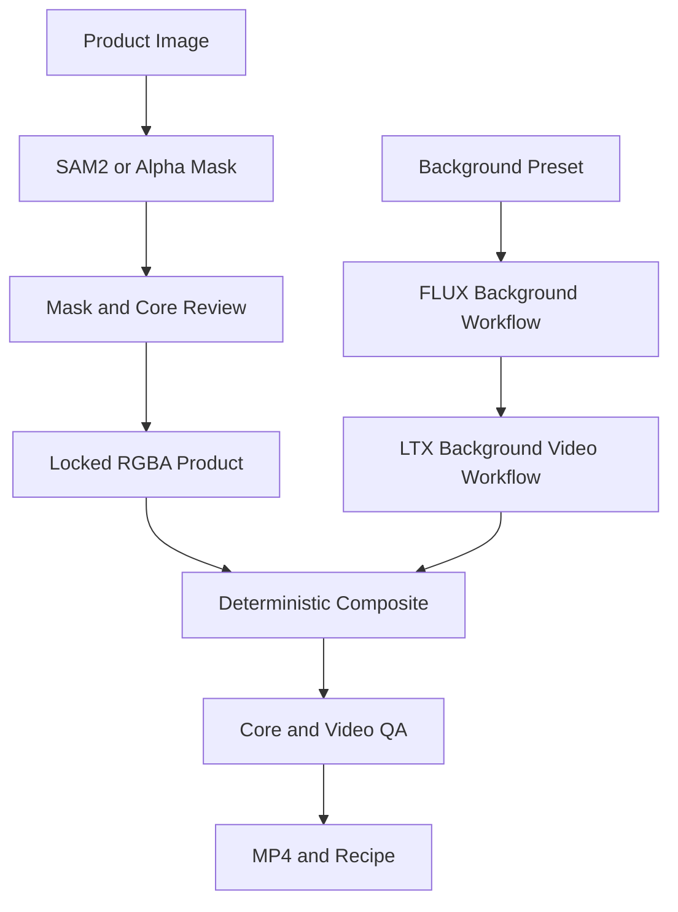

# Product Lock — 제품을 보존하는 광고 제작기

구현 스펙 v0.1 · 2026-10-19

## 1. 제품 목표

제품 사진 한 장을 업로드하고 배경을 선택하면, 제품의 로고·글자·형태를 원본에서 가져와 유지하면서 짧은 광고 영상을 만든다. 핵심은 생성 모델의 제품 재현 능력에 의존하지 않고 제품과 생성 배경을 분리하는 것이다.

대표 사용자: 상세 페이지·SNS용 소재를 만드는 소규모 브랜드 운영자. 대표 시나리오: 음료 캔 사진 업로드 → 제품 경계 확인 → Neon Studio 선택 → 배경 이미지 확인 → 5초 광고 생성 → 라벨 확대 비교 → 세로 MP4 다운로드.

공통 서버·저장·job·배포 계약은 `00_SHARED_IMPLEMENTATION_SPEC.md`를 따른다. 이 문서의 API는 모두 자체 앱 API다.

## 2. 범위와 제품 약속

| P0 포함 | P0 제외 |
|---|---|
| 단일 불투명 제품, 원본 alpha 또는 클릭 기반 분리 | 투명 유리/반투명 액체의 정확한 matting |
| 제품 마스크 브러시 보정, core 보호영역 표시 | 360도 제품 회전, 새로운 측면 생성 |
| 배경 3종, 이미지 후보 1개씩 명시 생성 | 모델이 제품을 손에 들거나 제품과 상호작용 |
| 원본 제품 고정 + 배경 영상 생성 | 제품을 포함한 전체 frame의 diffusion 재생성 |
| 그림자·후경 입자·광량 변화 | 제품 core에 relighting, 반사·굴절의 물리적 재현 |
| 비율 16:9/9:16, 길이 5초, MP4 | 4K, 카탈로그 batch, 결제, 자동 게시 |
| 제품 보존 검사, 레시피 다운로드 | 검증 없는 '원본과 100% 동일' 광고 문구 |

보존의 정확한 정의: normalize된 원본에서 추출한 제품을 동일 transform으로 합성하며, alpha=1인 core에는 생성·색보정·입자를 적용하지 않는다. 크기 변경에 의한 resampling과 MP4 손실 압축은 발생한다. 따라서 원본 파일 전체와 최종 영상이 byte-identical하다고 주장하지 않는다.

전체 제품의 외곽은 feathering할 수 있지만 사용자가 지정한 라벨/core 내부는 opaque로 유지한다. P0는 제품 위치·크기를 영상 내 고정한다. 제품을 움직이는 기능은 P1이고, 그때는 expected reference transform도 frame별로 계산해야 한다.

## 3. 화면과 UI 스타일

톤: 차분한 상업 사진 스튜디오. 밝은 편집 패널과 중립 회색 작업대를 사용해 제품 색상을 판단하기 쉽게 한다. 장식적인 gradient 대신 출력물에 시선이 가게 한다.

| Token | 값 |
|---|---|
| app background | #F5F4F0 |
| panel | #FFFFFF |
| stage | #E9E8E3, transparent grid 토글 |
| text / muted | #171A18 / #666D68 |
| accent | #18794E, 주요 CTA Generate ad |
| border | #DADDD7 |
| core overlay | 초록 hatch + Protected label |
| radius | panel 12px, button 8px |

### 화면 A — 시작

좌측에 제품 업로드 1개, 우측에는 실제 제공하는 3개 preset 결과를 작은 sample gallery로 보여준다. CTA는 Upload product, 보조는 Try sample. 입력 권장: 제품 전체가 보이고 배경과 구분되는 불투명 제품. alpha PNG도 받는다. 제품 사진 업로드만으로 유료 생성은 시작하지 않는다.

### 화면 B — 편집기

상단: 프로젝트명, Saved, Undo/Redo, Export. 좌 패널 260px: Product thumbnail, Background preset 카드, 비율 선택. 중앙: 최종 output frame, 제품 선택 box, fit/100%/200% zoom. 우 패널 320px: 현재 도구와 설정. 하단: 5초 playbar와 배경 생성/렌더 결과 탭.

도구: Select product / Add area / Remove area / Protect label. alpha PNG는 alpha를 제안 마스크로 사용하지만 사용자 확인을 거친다. brush 크기 2~80 source px, undo 가능. 라벨 보호 box는 core 마스크와 결합한다. 보호 box가 제품 밖으로 벗어나면 clipping하고 안내한다.

Inspector 그룹:

- Product: 위치 x/y, 폭 비율 15~70%, 경계 feather 0~4px(output 기준). core 영역을 침범하지 않는다.
- Scene: preset, 색상 선택 1개, 추가 지시 300자. 제품 자체를 묘사하는 입력 대신 배경 묘사로 제한한다.
- Lighting: background brightness -20~20%, shadow opacity 0~60%, contact shadow blur 0~40px. 제품 밝기 조절은 P0에서 제공하지 않는다.
- Motion: subtle/balanced. 제품 고정 label, 배경 움직임만 적용.
- Output: portrait/landscape, 고정 5초.

CTA는 Generate background와 Render ad 두 단계다. 이미 생성된 배경을 그대로 쓰면 재렌더에서 배경 생성 비용을 쓰지 않는다. 배경 선택 전에 Render ad는 disabled. Generate를 누를 때 estimate와 새 job 사용 여부를 짧게 보여준다.

### 화면 C — 결과

원본 제품/결과를 번갈아 보여주는 toggle, 라벨 200% 확대, Protected core inspection. 결과에는 성공 상태와 별개로 검증 결과를 표시한다. 압축 전 core 검사 통과를 '제품 보호 확인'으로 표시하고, 인코딩 결과 검사는 별도 '영상 압축 확인'으로 표시한다. Export MP4 / Cover PNG / Recipe ZIP.

모바일: stage 위, 하단 Product/Scene/Output 탭. 정밀 mask brush는 확대 후 사용하고 alpha PNG+기본 segmentation 흐름으로도 완료할 수 있게 한다.

## 4. 시스템 아키텍처



분리/배경 생성/배경 영상/합성은 각각 재시도 가능한 stage다. 같은 config의 제품 cutout과 mask는 cache한다. 배경 생성에는 제품 원본 픽셀을 전달하지 않는 strict profile을 기본으로 한다. 사용자 선택 제품 category는 배경 공간·색감 prompt 생성에만 사용한다.

## 5. 모델과 API 선택

| 작업 | P0 선택 | 구현 방식 |
|---|---|---|
| 제품 분리 | SAM 2.1 small checkpoint | 공식 image predictor를 자체 Comfy node로 감싼다. 클릭·box prompt 입력 |
| 투명도 | alpha PNG 우선 | alpha를 그대로 읽고 opaque core 계산 |
| 배경 이미지 | FLUX.1-schnell | Comfy workflow에서 text-to-image. 제품 없는 배경 생성 |
| 배경 영상 | LTX-2.3 distilled v1.1 | 공식 image-to-video graph 기반, 배경 이미지에서 짧은 영상 생성 |
| 제품/그림자 합성 | 자체 node + NumPy/OpenCV | 결정적 alpha composite, 간단 contact shadow |
| 인코딩 | FFmpeg | Comfy 출력 또는 CPU 후처리로 H.264 MP4 |

모델 선택의 이유: SAM은 클릭 수정 인터페이스에 맞고, FLUX schnell은 생성 배경의 빠른 반복을 위한 기본값이다. LTX는 배경의 움직임을 만든다. 이 선택은 품질·비용 실측 후 profile로 고정한다. API형 이미지 모델은 P1 대체 profile이며 P0에는 필수 API가 아니다.

공식 출처: [SAM 2](https://github.com/facebookresearch/sam2), [FLUX schnell](https://huggingface.co/black-forest-labs/FLUX.1-schnell), [LTX Comfy examples](https://github.com/Lightricks/ComfyUI-LTXVideo). 모델별 license와 encoder 조건은 model manifest에 기록한다.

FLUX schnell을 inpainting 모델로 취급하지 않는다. 빈 배경을 먼저 만들고 그 위에 제품을 올린다. LTX에 제품 보존을 요청하는 prompt만으로 보존을 구현하지 않는다.

## 6. Workflow와 자체 노드

### `product_segment_v1`

Load normalized image → alpha 존재 시 alpha 추출, 없으면 SAM image predictor → 사용자 add/remove prompt 반영 → mask asset 저장. 클릭 prompt는 source normalized 좌표로 저장한다. 여러 물체가 선택되면 largest component만 강제 선택하지 말고 UI에서 선택하게 한다.

### `product_background_image_v1`

Preset prompt + color + composition → FLUX text-to-image → image output. 제품 배치 영역을 흰색으로 만드는 식의 가짜 inpaint는 사용하지 않는다. 중앙 제품 preset은 중앙에 다른 물체가 없는 배경으로 유도한다. 결과에 의도하지 않은 물체가 있으면 사용자가 재생성한다.

### `product_background_video_v1`

선택된 배경 image → LTX I2V → background frame sequence. 카메라 고정과 미세한 후경 움직임을 prompt로 유도하되 성공 여부는 결과 검사와 사용자 선택에 맡긴다. 배경 카메라가 크게 움직이면 제품이 떠 보일 수 있어 preset에서 금지하고 재생성을 제안한다.

### `product_composite_v1`

고정 product RGBA + product transform + background frames → contact shadow → 후경 particles → product composite → core 검사 → lossless preview frame/MP4 output. contact shadow는 제품 뒤 레이어로만 적용한다. 전경 particles와 제품 위 glow는 P0 제외한다.

| 자체 node — 신규 구현 명칭 | 입력 | 출력 |
|---|---|---|
| PLProductMask | IMAGE, alpha 또는 prompts JSON | MASK, diagnostics |
| PLLockedProduct | IMAGE, MASK, core_mask, transform | product RGBA asset, expected core reference |
| PLBackgroundPrompt | preset_id, color, composition | positive prompt, preset_version |
| PLCompositeSequence | product RGBA, background sequence, shadow config | frame sequence manifest |
| PLCoreIntegrityCheck | expected reference, composed frame manifest, core mask | QA JSON |

이 이름들은 기존 Comfy 노드라고 가정하지 않는다. alpha는 IMAGE의 4번째 channel로 임의 취급하지 않고 IMAGE RGB + 별도 MASK로 다루거나 명시적 RGBA asset으로 전달한다. 큰 sequence는 파일 manifest 형식으로 streaming한다.

## 7. 합성·보존 알고리즘

제품의 normalize된 RGB를 P, alpha를 A, transform을 T, 배경을 B_t로 정의한다. T(P,A)는 동일 interpolation 설정으로 resample한다. feather는 alpha 경계 band에서만 적용하고 core는 1로 고정한다. premultiplied alpha로 합성해 흰색 fringe를 줄인다.

`C_t = A_T * P_T + (1 - A_T) * B_t`.

core는 사용자가 보호한 영역 및 erosion한 opaque product mask의 합집합을 제품 내부로 제한한다. 경계 색상 decontamination은 edge band에만 선택 적용한다. shadow는 alpha를 바닥 방향으로 변형한 단순 근사이며, 물리적으로 정확한 접촉·반사를 보장하지 않는다.

검증: 동일한 T와 색공간으로 만든 expected product reference와 무손실 composed frame의 core RGB 비교. P0 threshold는 max channel error ≤ 1/255(반올림 허용), mask가 비어 있으면 통과가 아니라 invalid core. 이는 압축 전 구현 정확성 검사다. MP4 decode 후에는 core SSIM/평균오차를 진단하고 threshold는 fixture로 보정한다. OCR은 설치 profile에 있으면 라벨 경고용으로만 추가하며 보존의 판정 근거로 단독 사용하지 않는다.

## 8. 설정 스키마

```json
{
  "schema_version": 1,
  "product_asset_id": "uuid",
  "mask_asset_id": "uuid",
  "core_mask_asset_id": "uuid",
  "transform": {"center_x": 0.5, "center_y": 0.55, "width_ratio": 0.36, "rotation_deg": 0},
  "scene": {"preset_id": "neon_studio_v1", "accent_hex": "#965EFF", "extra_prompt": "", "background_asset_id": "uuid"},
  "shadow": {"enabled": true, "opacity": 0.28, "blur_px": 18},
  "motion": "subtle",
  "output": {"aspect": "9:16", "duration_ms": 5000, "fps": 24},
  "seed": 12345,
  "model_profile": "open_weights_v1"
}
```

한 프로젝트의 output은 하나의 비율만 사용한다. 비율 변경은 background 재생성 필요 여부를 알리고 기존 asset을 버리지 않는다. transform.rotation_deg는 P0에서 0만 허용한다.

## 9. 앱별 API

공통 `/projects/{id}/jobs`의 kind:

| kind | options | 산출물 |
|---|---|---|
| product.segment | `{points:[{x,y,label}],box?}` | mask, cutout preview |
| product.background | `{preset_id,seed}` | 배경 이미지 |
| product.background_video | `{background_asset_id,seed}` | 배경 영상 |
| product.render | `{reuse_background_video_asset_id?}` | 최종 MP4, cover, QA |
| product.inspect | `{render_job_id}` | core 비교 crop/QA |

마스크 브러시는 UI에서 raster mask PNG로 저장하고 공통 asset API로 업로드한다. mask dimensions가 normalized product와 다르면 422. segment request는 revision을 고정하며, 늦게 끝난 segmentation이 최근 수동 수정 mask를 덮어쓰지 않는다.

추가 read API: `GET /api/v1/product-lock/presets` → id/version/thumbnail/allowed_motion/prompt_fields. `GET /api/v1/jobs/{id}/integrity` → core_valid, preencode_max_error, postencode_metrics, preview_asset_ids. UI는 원본 비교 검사를 구현한 경우에만 보호 확인 badge를 표시한다.

## 10. Preset 사양

| Preset | 배경 | 움직임 | 제한 |
|---|---|---|---|
| Soft Studio | 무광 단색, 바닥 plane, 부드러운 그라데이션 | 작은 후경 조명 변화 | 입자 없음, 기본 sample |
| Neon Studio | 어두운 studio, 후경 네온 line | 후경 line/빛의 느린 변화 | 제품 위 light overlay 없음 |
| Botanical | 잎과 자연광이 있는 후경 | 잎 그림자·bokeh의 미세 이동 | 제품을 덮는 잎 생성은 sample로 배제 |

각 preset은 승인된 seed 예시를 제공하되 사용자가 생성한 모든 결과가 동일 품질이라는 가정을 하지 않는다.

## 11. 실패·복구 UX

- 얇은 손잡이/반투명 제품: '경계를 직접 보정하거나 배경이 제거된 PNG를 사용하세요'. 무조건 고품질 cutout이라고 표시하지 않는다.
- core가 너무 작음: Generate 전에 경고, 라벨 보호영역 설정으로 이동.
- 배경 영상 실패: 선택된 이미지/제품 편집 유지, background_video stage만 다시 실행.
- core 검사 실패: 다운로드 가능한 preview에 QA warning, 원인을 확인한 뒤 deterministic composite 재실행. diffusion 재생성으로 해결하지 않는다.
- 생성 중 제품 편집: 현재 job은 기존 revision, 새 편집은 다음 render에 적용.

## 12. 검증과 완료 기준

| 항목 | P0 통과 조건 |
|---|---|
| 제품 보호 | 불투명 제품 fixture 5개에서 모든 frame의 preencode core 검사 통과 |
| 마스크 | 원본 alpha/클릭 segmentation/수동 brush 세 경로로 완료 가능 |
| 레이어 | shadow·입자·배경 색 변화가 core를 바꾸지 않음 |
| 출력 | 세로/가로 5초 영상, play/download 정상, metadata 일치 |
| 비용 | 배경 재사용 render는 배경 생성 provider stage를 실행하지 않음 |
| 버전 | 렌더 중 수정해도 기존 결과와 integrity report가 같은 revision 참조 |
| 실추론 | 배포 Comfy의 FLUX→LTX→합성 경로 최소 1개 실제 성공 |

성능 측정 목표: CPU-only 제품 배치 preview는 편집 후 100ms 이내, mask 결과는 워밍 상태 10초 이내, 최종 render는 5분 이내를 우선 목표로 한다. GPU/배포별 실측으로 조정하며 SLA가 아니다. 대량 프레임 처리에 48GB급 GPU를 시작 후보로 잡되 필수 VRAM 수치는 실제 build에서 측정한다.

## 13. 구현 순서·데모

P0-A: alpha PNG 제품+고정 배경으로 editor/합성/core 검사/MP4를 완료. P0-B: SAM과 mask editor 연결. P0-C: FLUX 배경 생성. P0-D: LTX 배경 영상 연결. P0-E: 세 preset, 실제 deployment, 공개 recipe와 오류 처리.

60초 데모: 작은 글자가 있는 캔 업로드 → 라벨 보호영역 설정 → 배경 생성 → 영상 → 원본/결과 라벨 확대 → core 검사 → workflow 다운로드. 단순 프롬프트형 광고 생성기와의 차이를 영상 품질보다 제품 보존 동작으로 보여준다.

P1: 전경 효과, 경계 matting 개선, 제품별 다중 shot, 여러 비율 재배치. 제품 relighting·회전은 별도 모드로 설계하고 strict preservation label을 유지한 채 제공하지 않는다.
