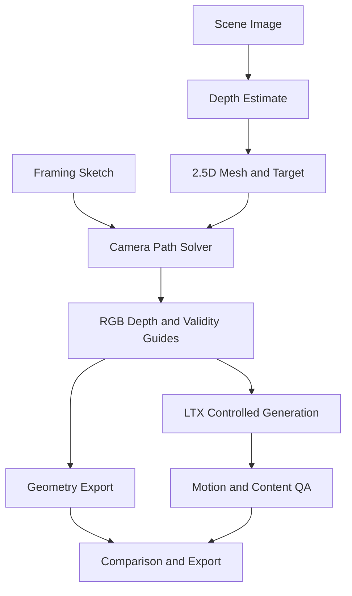

# Camera Sketch — 그려서 지시하는 카메라

구현 스펙 v0.1 · 2026-10-19

## 1. 제품 목표

사진 한 장에서 주목할 피사체를 클릭하고 카메라 이동을 스케치하면, 실제 경로를 확인한 뒤 짧은 카메라 이동 영상을 만든다. 입력 경로를 프롬프트 문장으로만 바꾸지 않고 깊이 기반 장면의 카메라 transform과 조건 영상으로 변환한다.

대표 사용자: 프리비즈·광고 숏을 빠르게 탐색하는 제작자. 대표 시나리오: 실내 사진 업로드 → 의자 클릭 → 왼쪽 이동 경로 그리기 → 깊이 기반 즉시 preview 확인 → Render Geometry 또는 Generate Cinematic → 경로 overlay와 결과 비교.

공통 구현은 `00_SHARED_IMPLEMENTATION_SPEC.md`를 따른다. 아래 API는 자체 API다. UI 경로는 실제 3D 카메라 위치와 구분해 표시한다.

## 2. 핵심 결정 — 모드 두 개

| 모드 | 구현 | 사용자에게 약속하는 것 |
|---|---|---|
| Geometry | 단안 depth로 만든 2.5D 장면을 지정 카메라로 렌더 | 입력 카메라 경로를 렌더러가 따름. 큰 시점 변화의 실사 재현은 보장하지 않음 |
| Cinematic | Geometry의 RGB/depth guide를 LTX conditioning으로 넣어 재생성 | 같은 경로의 guide를 사용해 시각 품질을 개선. 정확한 camera pose 보장은 없음 |

첫 화면에는 Geometry preview를 먼저 보여주고 Cinematic은 명시 버튼으로 실행한다. 두 결과는 별도 asset이고 원본 Geometry를 덮어쓰지 않는다. 결과 badge는 '경로 렌더'/'AI 생성'으로 구분한다. 모든 Cinematic 결과에 exact camera control이라고 표시하지 않는다.

Geometry만 완성하면 유용한 프리비즈 도구지만 생성 앱으로서의 데모는 약하다. 해커톤 제출 목표에는 실제 LTX-conditioned 결과 1개 이상을 포함한다.

## 3. P0 범위

포함: 단일 정적 사진, 단안 depth, 피사체/target 클릭, 제한된 path sketch, 3 preset, 카메라 gizmo, RGB/depth guide, Geometry export, LTX Cinematic, 원본/guide/생성 비교.

제외: 360도 orbit, 뒤쪽 물체의 정확한 복원, 여러 사진 SfM, NeRF/3DGS 학습, 움직이는 인물 pose 조작, 한 숏 안의 lens 변경, 긴 영상, 6DoF 임의 이동. P0에서 '작은 arc'는 최대 ±6°의 정면 주변 이동이며 뒤쪽으로 돌아가는 orbit가 아니다.

기본 길이 5초, landscape/portrait, 24fps. 경로 control point는 2~5개. 과도한 이동은 preview에서 invalid 또는 clamp로 표시하고 사용자가 적용하도록 한다. 입력을 조용히 바꾸지 않는다.

## 4. UI 스타일·화면

톤: 영화 프리비즈 도구. 어두운 neutral canvas에 cyan 경로, amber look-at target을 사용한다. 과한 glassmorphism을 피하고 피사체와 경로가 선명하게 보이게 한다.

| Token | 값 |
|---|---|
| app background | #101216 |
| panel | #191D24 |
| stage | #0A0C10 |
| text / muted | #F0F3F8 / #A3ACB9 |
| border | #303845 |
| camera path | #66DCF2 |
| target | #F0BA65 |
| generated mode accent | #B89BFF |
| radius | panel 10px, controls 6px |

### 시작 화면

Upload scene / Try sample. 예시는 실내·제품 테이블·건축 외관 3개. 권장 입력은 전경/후경이 나뉘고 반사면이 적은 정적 사진. 업로드 후 Analyze scene은 depth 작업만 실행한다. 아직 영상 생성 비용을 쓰지 않는다.

### 편집기

좌 240px: Scene, Depth, Path preset. 중앙 큰 Camera view, 우 위 작은 Top/Side view(220×160px), 우 inspector 320px. 하단 140px: 0~5초 timeline, keyframe marker, easing curve preset.

중앙 도구는 Select target / Sketch framing / Move keyframe. target을 누르면 amber reticle, 경로는 cyan, 시간 keyframe은 번호를 붙인다. source 이미지에 그린 선은 화면상의 framing 요청이다. 실제 카메라 위치는 우측 Top/Side gizmo에서 확인한다. 'Sketch'와 'Camera path' label을 구분한다.

마우스 down→최대 128 raw points 수집→Ramer–Douglas–Peucker 단순화→2~5 control point. 사용자가 선을 그린 방향을 그대로 시간 순서로 사용한다. 경로를 닫힌 loop로 만들거나 뒤로 크게 꺾으면 지원 범위 안내와 preset 복구 버튼을 제공한다.

Inspector:

- Target: x/y 좌표, depth near/far 보정. 피사체를 클릭하면 자동 depth 제안.
- Camera: preset, lateral motion -0.05~0.05 scene units, push 0~0.10 target depth, focal length 35~70mm equivalent, roll 고정 0.
- Path: control point 시간·position, easing linear/ease-in-out, reset path.
- Scene: depth contrast, edge protection, hole visualization.
- Render: Geometry/Cinematic, fixed length, seed, generated guidance low/medium/high profile.

focal length는 EXIF로 실제 측정했다는 뜻이 아니라 synthetic camera 설정이다. P0는 한 숏 동안 고정. 스크롤 wheel은 stage 확대만 바꾸고 실제 카메라 focal length를 바꾸지 않는다.

### 결과 화면

탭 Source / Geometry / Depth guide / Cinematic. 두 영상의 playback을 같은 timestamp로 맞춘다. intended path overlay는 preview에만 있고 export에서는 선택 off 기본. 결과 상단에 Geometry의 hole 비율과 Cinematic 검사 상태를 표시한다. 영상·경로 JSON·guide·workflow 다운로드.

모바일은 원본 위 freehand 정밀 경로 대신 3개 preset+강도 slider가 기본이다. 모든 desktop 경로를 모바일에서도 확인·재생 가능하되 임의 keyframe 숫자 입력은 bottom sheet로 제공한다.

## 5. 아키텍처



프론트 Three.js는 즉시 preview, 서버 renderer는 guide와 Geometry export의 기준이다. 두 구현은 동일 camera convention·intrinsics·interpolation library fixture를 공유한다. 브라우저 preview와 서버 geometry가 다르면 server를 기준으로 수정한다. P0에서 고비용 inverse rendering을 넣지 않는다.

## 6. 모델·API

| 작업 | 선택 | 비고 |
|---|---|---|
| Depth | Depth Anything V2 Small | 상대 깊이. 실제 meter가 아님 |
| Guide render | 자체 2.5D renderer + PyTorch/NumPy | 고정된 projection과 z-buffer, CPU reference 제공 |
| 즉시 preview | Three.js | 서버 depth map을 로드, 같은 camera transform 적용 |
| Cinematic | LTX-2.3 distilled + 동일 버전 union IC-LoRA | depth/edge 예제 기반, actual installed graph로 binding |
| Encoder | FFmpeg | guide/최종 frame의 시간·비율 정규화 |

공식 자료: [Depth Anything V2](https://github.com/DepthAnything/Depth-Anything-V2), [LTX Comfy examples](https://github.com/Lightricks/ComfyUI-LTXVideo). Depth V2 Small을 명시적으로 선택하고 임의로 Large로 바꾸지 않는다. depth/edge conditioning은 경로 추종을 유도하는 수단이며 camera matrix를 직접 강제하는 API가 아니다.

이미지 한 장에서 없는 영역이 드러나는 문제를 LTX가 항상 해결한다고 가정하지 않는다. 공식 예제의 가중치·encoder·LoRA를 함께 고정하며 다른 세대의 camera LoRA를 섞지 않는다. LTX-2.0의 dolly LoRA를 2.3 checkpoint에 무조건 장착하지 않는다.

## 7. Geometry 파이프라인

### 7.1 Depth 정규화와 scene 생성

이미지 normalized pixel을 (u,v), 상대 inverse depth를 d라 한다. depth 모델 출력의 의미를 adapter에서 명시하고, inverse-depth라면 `z = scale / max(d + offset, eps)`로 변환한다. 단순히 밝은 pixel을 meter 값으로 사용하지 않는다. foreground/background 방향을 fixture에서 검증한다.

depth outlier는 percentile clipping 후 완만한 edge-aware smoothing. target 주변 median z를 1 scene unit으로 normalize한다. synthetic intrinsics K로 `X = z * K^-1 * [u,v,1]`을 생성한다. mesh triangle은 인접 vertex의 depth 차가 threshold를 넘으면 연결하지 않아 전경 경계의 고무막을 줄인다.

좌표계는 OpenCV식 camera x 오른쪽/y 아래/z 앞쪽, pose는 world-to-camera `T_cw`로 저장한다. Three.js의 y/z convention으로 옮기는 변환은 한 곳에서만 수행한다. `T_wc`가 필요하면 inverse해서 쓰고 이름을 혼용하지 않는다.

### 7.2 Sketch→camera path

P0에서 스케치는 임의 3D translation 명령이 아니다. target을 화면의 어디에 배치할지 나타내는 framing path다. raw sketch를 frame 안의 2~5 desired target screen positions로 변환한다. 카메라 lateral 위치가 먼저 제한된 preset curve를 따르고, 각 keyframe의 yaw/pitch를 풀어 target projection이 desired framing에 가깝게 오도록 한다. Push slider는 z translation을 추가한다.

해결 objective: target screen error + camera velocity smoothness + acceleration penalty. position bound와 target visibility를 hard constraint로 둔다. 가벼운 bounded least-squares를 쓰며 solver 실패 시 마지막 유효 경로 또는 preset으로 복귀한다. 모든 keyframe이 같아도 정지 카메라가 정상 결과다.

Preset:

| ID | 이동 | Target |
|---|---|---|
| push_in | target depth의 0~10% 접근 | 선택한 target 유지 |
| slide | x ±0.05 target depth | 사용자의 framing path 따라 yaw 보정 |
| small_arc | target 중심 최대 ±6° arc | look-at target. 큰 orbit 불가 |

P0는 multi-axis 임의 자유곡선을 억지로 허용하지 않는다. numeric endpoint 이동과 스케치를 함께 보여 실제로 해석된 path를 사용자가 확인한다.

### 7.3 Frame 렌더와 hole 처리

각 t에서 camera pose interpolation → mesh projection → z-buffer → RGB/depth/validity raster. interpolation은 position cubic easing, orientation quaternion slerp. 시작·끝 pose를 정확히 포함한다. near/far clipping을 적용한다.

disocclusion mask는 유효 geometry가 없는 pixel이다. 배경을 늘려 복사해 모든 hole을 valid로 만들지 않는다. 4px 이하의 작은 hole은 deterministic inpaint 가능, 큰 hole은 validity mask로 남긴다. preview에서 checkerboard/red hatch overlay로 확인한다.

초기 제안 guardrail: max frame hole ratio 8% 초과 또는 target visibility 90% 미만이면 경로가 과도하다는 안내. 이 수치는 제품 정책이며 실제 fixture로 조정한다. 자동 clamp를 적용하려면 before/after overlay와 Apply reduced motion을 제공한다.

## 8. Cinematic 파이프라인

guide RGB/depth/edge sequence → 공식 LTX control workflow 입력 → seed 고정 sampler → decode → crop/trim → 품질 검사. depth guide는 frame마다 별도 min-max normalize하지 않고 전체 숏에서 고정한 범위를 사용해 temporal flicker를 줄인다. invalid 영역 mask와 fill strategy를 trace에 남긴다.

후처리에서 생성 영상의 단순 2D 이동을 desired camera path로 보정해 '정확한 경로'라고 주장하지 않는다. reference target 주변 feature tracking과 image similarity로 경고를 낼 수 있지만, 일반 생성 영상의 실제 3D camera pose를 확정적으로 추정하지 않는다.

guidance가 약하면 경로 편차, 강하면 hole/mesh artifact 전사가 생길 수 있다. low/medium/high는 실제 graph의 허용된 control strength 범위로 preset화하고 첫 smoke에서 값 고정. UI에 임의로 존재하지 않는 conditioning parameter를 만들지 않는다.

## 9. Workflow·노드 계약

| Workflow | 입력 | 출력 |
|---|---|---|
| camera_depth_v1 | scene image | raw depth, preview depth, metadata |
| camera_guide_v1 | image, raw depth, path JSON, intrinsics | RGB/depth/validity sequence, geometry MP4 |
| camera_cinematic_v1 | guide sequence, source reference, prompt, seed | generated sequence/MP4 |
| camera_compare_v1 | guide/result, path | synchronized comparison assets, QA |

| 신규 자체 node | 책임 |
|---|---|
| CSDepthToScene | depth convention과 scale 고정, mesh와 K 생성 |
| CSCompileCameraPath | sketch/preset→bounded keyframes와 diagnostics |
| CSRenderGuides | RGB/depth/validity frame manifest 생성 |
| CSPathDiagnostics | projection error, target visibility, hole ratio |
| CSGeneratedMotionReport | feature tracking 진단. 실패 시 unknown |

renderer의 frame 출력은 RGB IMAGE와 depth tensor의 범위를 분리한다. LTX용 depth color mapping은 control example과 일치시킨다. Three.js canvas PNG capture를 최종 학습/추론 guide의 유일한 생성기로 쓰지 않는다.

## 10. 데이터 스키마

```json
{
  "schema_version": 1,
  "scene_asset_id": "uuid",
  "depth_asset_id": "uuid",
  "target": {"u": 0.52, "v": 0.48, "depth_scale": 1.0},
  "camera": {"focal_length_mm_equiv": 50, "sensor_width_mm_assumed": 36, "roll_deg": 0},
  "path": {
    "preset": "slide",
    "sketch_space": "target_screen_position",
    "sketch_points": [{"t": 0, "u": 0.5, "v": 0.5}, {"t": 1, "u": 0.55, "v": 0.5}],
    "lateral_ratio": 0.04,
    "push_ratio": 0,
    "easing": "ease_in_out"
  },
  "mode": "cinematic",
  "generation": {"seed": 12345, "control_preset": "medium", "extra_prompt": "subtle natural lighting"},
  "output": {"aspect": "16:9", "duration_ms": 5000, "fps": 24}
}
```

서버의 compiled path artifact는 `coordinate_convention`, `K`, `T_cw[t]`, sample timestamp, source-to-output transform, depth mapping, solver version을 포함한다. 사용자 config와 compiled artifact를 둘 다 저장해 solver 업데이트 후에도 이전 결과를 설명할 수 있게 한다.

## 11. 앱별 API

`GET /api/v1/camera-sketch/presets`는 supported motion과 bound를 반환한다. `POST /api/v1/projects/{id}/camera-path/compile`은 `{revision,sketch,preset,parameters}`를 받아 path artifact와 warning을 반환한다. compile은 작은 CPU 작업으로 2초 목표; timeout이면 일반 job으로 넘긴다. 클라이언트 preview는 서버 승인 전 provisional 표시.

공통 job endpoint kind:

| kind | 산출물 |
|---|---|
| camera.analyze | depth asset, depth convention, intrinsics 제안 |
| camera.guide | compiled path, guides, Geometry MP4, diagnostics |
| camera.cinematic | guide job 참조, generated MP4, diagnostics |
| camera.export | MP4, path JSON, guide/depth, workflow ZIP |

camera.cinematic은 succeeded guide job의 immutable input revision과 generation 설정을 연결한다. 영상 길이와 guide frame count가 다르면 422로 차단하고 조용히 비율을 변경하지 않는다. scene 교체 후 이전 depth/path를 재사용할 수 없다.

## 12. 실패와 품질 판정

- 반사·유리·하늘에서 depth 부정확: target depth 조절, 작은 이동 권장, depth overlay 제공.
- hole 과다: Generate 전에 warning, 이동 줄이기 preset 제공. Geometry export 자체는 warning 확인 후 허용.
- Cinematic이 target을 바꿈: 결과 유지하고 '피사체 변화 감지/확인 필요' 표시. guide 또는 다른 seed 선택.
- feature tracking 불가: score 0이나 pass 대신 unknown. 장면 texture 부족 설명.
- solver 실패: 유효하지 않은 path로 GPU 실행 금지. 마지막 유효 path로 복귀 가능.

## 13. 검증과 완료 기준

| 항목 | 통과 조건 |
|---|---|
| 좌표계 | 알려진 depth의 synthetic plane/box fixture에서 좌·우·push 방향이 기대와 일치 |
| 정지 경로 | T가 고정이면 모든 Geometry frame이 동일하고 불필요한 이동 없음 |
| 프론트/서버 | 고정된 3개 keyframe의 target projection 차이 ≤ output 2px |
| Path solver | 유효 fixture에서 target framing RMS error ≤ output 짧은 변의 1% |
| 가림 | 전경 뒤쪽 triangle이 앞으로 튀어나오지 않고 hole을 올바로 표시 |
| 길이 | output 120 frames/24fps, 모델 내부 frame 규칙과 분리 |
| 버전 | exported path와 workflow가 결과의 input revision을 가리킴 |
| 실추론 | 최종 배포에서 depth guide→LTX 결과를 최소 1개 생성 |

Cinematic 품질은 자동 점수만으로 보장하지 않는다. 검증 세트 6장×3 preset에 대해 방향·피사체 유지·artifact를 각각 수동 평가하고 실패 입력을 기록한다. '특정 정확도 달성'은 이 구현을 실행·측정하기 전에는 주장하지 않는다.

성능 목표: depth 준비 후 브라우저 30fps preview(표준 노트북, 낮은 mesh resolution), path edit 100ms 안에 시각 반영. 고해상도 guide는 비동기. LTX GPU 시간은 첫 smoke에서 측정해 UI 예상 시간을 갱신한다.

## 14. 구현 단계와 데모

P0-A: synthetic depth fixture + path compiler + browser/server renderer 일치. P0-B: 실제 depth inference + target UI + hole overlay. P0-C: guide export. P0-D: 같은 guide의 LTX conditioning. P0-E: 비교 화면/recipe/배포.

데모: 사진에서 target 클릭 → 선을 오른쪽으로 그림 → Top view에서 실제 카메라 이동 확인 → Geometry 즉시 재생 → depth guide 확인 → Cinematic 결과 → 두 모드 차이와 공개 path JSON 소개.

첫 48시간에 depth-conditioned LTX 경로의 smoke가 실패하면 먼저 Geometry를 완성하고, 생성 모드는 공식 예제에서 지원하는 작은 slide로 좁힌다. 임의 path 지원이나 완전한 orbit를 추가하는 방향으로 범위를 늘리지 않는다.
