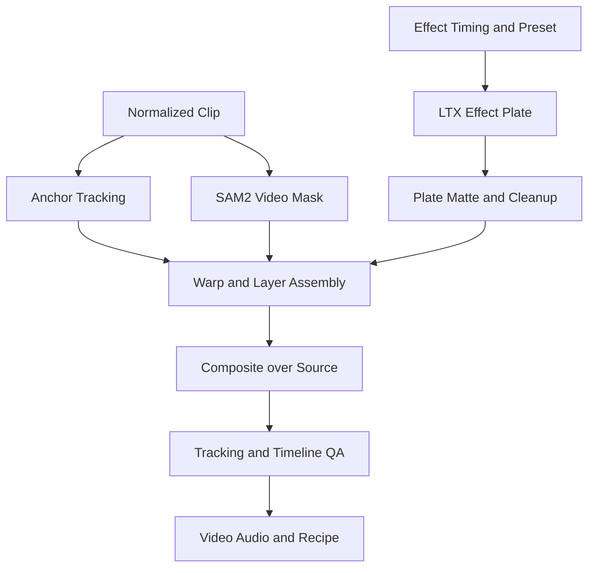

# Pocket VFX — 스마트폰 영상에 붙이는 영화 효과

구현 스펙 v0.1 · 2026-10-19

## 1. 제품 목표

직접 촬영한 3~5초 영상에서 효과를 적용할 순간과 대상을 지정하면, 원본의 사람·장면을 유지하면서 추적된 효과를 합성한다. 예: 주먹을 내미는 순간 클릭 → 손을 따라가는 에너지 효과 → 인물이 효과를 가리는 관계까지 반영한 영상.

일반적인 video-to-video 재생성만으로 원본 전체를 다시 그리지 않는다. 원본을 base layer로 유지하고 effect plate, tracking, occlusion, composite를 편집 가능한 레이어로 관리한다. 생성 모델은 효과 소재 제작에 활용한다.

공통 구현은 `00_SHARED_IMPLEMENTATION_SPEC.md`를 따른다. 아래 API는 자체 API다.

## 2. 효과와 P0 범위

| Preset | 경험 | 기본 구현 | 생성 요소 |
|---|---|---|---|
| Impact Wave | 지정 순간에 지면 충격파가 퍼짐 | anchor 위치의 procedural ring + 먼지 합성 | LTX가 만드는 후경 먼지/빛 plate |
| Energy Aura | 선택한 인물/손 주변을 에너지가 따라감 | SAM mask/contour + glow + particle tracking | LTX energy texture plate |
| Blink Out | 인물이 입자와 함께 사라짐 | alpha dissolve + particles + clean plate | LTX particle texture, clean plate는 우선 빈 장면 입력 |

P0는 Impact Wave를 가장 먼저 완성하고 Energy Aura를 두 번째로 추가한다. Blink Out은 **고정 카메라+사용자가 제공한 빈 배경 frame**에서만 지원한다. 장면에 없는 배경을 완벽히 복원하는 기능으로 소개하지 않는다. 빈 배경이 없으면 세 번째 preset을 숨기고 해커톤 최소 데모는 첫 두 효과로 충족한다.

하나의 5초 클립, 한 명 또는 한 tracked object, 효과 1개, 발생 시간 1개. landscape/portrait, MP4 24fps. 고급 multi-effect stack, 자동 액션 인식, full body pose control, 움직이는 카메라에서 사람 제거, 물리 시뮬레이션, 얼굴 재생성은 P0 제외다.

두 렌더 profile을 구분한다. Quick는 procedural 소재+공개 bundled plate로 편집을 검증한다. Generate는 사용자의 설정에 따라 LTX plate를 생성한다. Quick만 시연하고 매번 AI가 생성한 것처럼 표시하지 않는다. LTX 관련 출품 부문은 실제 core workflow 요구를 충족하는지 확인하며 수상 자격을 보장하지 않는다.

## 3. UI 스타일·화면

톤: 모바일 촬영자를 위한 간결한 VFX 편집기. dark neutral에 orange CTA, magenta effect overlay. 긴 설정 panel보다 frame와 효과 위치 조작에 집중한다.

| Token | 값 |
|---|---|
| app background | #111113 |
| panel | #1C1C20 |
| stage | #080809 |
| text / muted | #F6F5F2 / #AAA8AE |
| accent CTA | #FF9A52 |
| effect overlay | #DD8BFF |
| tracking | #69D6A5 |
| warning | #F2C86B |
| radius | panel 12px, preset card 10px |

### 화면 A — 업로드와 trim

Upload clip / Try sample. 업로드 후 5초 이하 구간을 trim한다. 첫 프레임과 filmstrip은 normalize 작업 완료 후 제공한다. 회전된 스마트폰 영상도 화면과 좌표가 일치해야 한다. 원본 소리 유지 toggle은 on 기본, sample은 음원 권리를 확인한 무음 영상 사용.

### 화면 B — 편집기

상단 56px: 프로젝트명, Saved, Undo/Redo, Export. 좌측 220px: 효과 카드 3개. 중앙 stage: 영상, 클릭 anchor, mask overlay, tracking trajectory. 우측 300px: 효과 설정과 추적 상태. 하단 160px timeline: source filmstrip, playhead, effect in/out handle, peak event marker.

진입 순서: 효과 선택 → timeline에서 발생 순간 선택 → 영상에서 위치/대상 클릭 → Track → preview → Generate effect/Render.

tool은 Anchor / Select subject / Refine mask / Clean plate. Anchor는 위치와 transform에 쓰고 subject mask는 가림·aura contour에 쓴다. 점 하나를 찍었다고 정확한 손 뼈/3D 표면 tracking을 얻었다고 가정하지 않는다.

Inspector:

- Timing: 시작, peak, 종료. 0 ≤ start ≤ peak ≤ end ≤ clip duration.
- Position: anchor x/y, follow on/off, track window, manual correction keyframe.
- Effect: scale 0.25~2.0, intensity 0~1, palette preset 3개, rotation -180~180°.
- Depth order: Behind subject / In front / Split glow. 기본 Behind subject.
- Tracking: confidence timeline, Re-track from here, Reset.
- Audio: Keep original, effect SFX volume 0~100%. P0 SFX는 자체 제작/재배포 가능한 bundled asset.

stage overlay 우상단에 Source/Mask/Effect matte/Composite toggle. effects off를 누르면 원본 작업본으로 즉시 돌아간다. preview의 GPU 생성은 설정을 조금 바꿀 때마다 자동 재실행하지 않는다. scale·timing·색 조정은 생성 plate를 재사용한 로컬 proxy로 보여준다.

### 화면 C — 결과

before/after split 또는 toggle, 같은 timestamp playback. Export MP4, effect recipe, 가능 시 foreground/effect alpha ZIP. Quick 또는 Generated plate 출처, tracking 경고를 표시한다. 공개 공유는 명시 동작만 허용한다.

모바일은 stage+timeline 중심, 아래 Effect/Track/Adjust 탭. 손가락이 anchor를 가리지 않도록 touch loupe와 fine adjust arrow 제공. pinch는 stage zoom이고 효과 크기와 분리한다.

## 4. 아키텍처



CPU 전처리와 track/mask inference, effect plate inference, composite/encode를 stage로 분리한다. segmentation 결과와 plate는 독립 cache다. 사용자 timing·scale 변경은 plate 재생성 없이 render 가능해야 한다.

## 5. 모델·API·외부 의존성

| 작업 | P0 선택 | 사용 |
|---|---|---|
| 인물/대상 mask | SAM 2.1 small video predictor | 사용자 positive/negative point를 video state에 입력하고 propagate |
| anchor track | OpenCV pyramidal LK + forward/backward check | 짧은 2D point track. 수동 보정 지원 |
| global motion 진단 | background feature match + RANSAC homography | 고정 카메라 여부/흔들림 진단. 실제 3D 재구성 아님 |
| effect plate | LTX-2.3 distilled v1.1 | 효과별 prompt/reference로 2~3초 texture/먼지/에너지 영상 생성 |
| effect geometry | 자체 procedural renderer | ring/particles/glow, 시간 곡선과 seed 결정적 |
| 합성 | OpenCV/NumPy + 자체 Comfy node | mask·tracking·blend·motion blur |
| encoding/audio | FFmpeg | source audio mux, optional SFX mix |

SAM 공식 자료: https://github.com/facebookresearch/sam2 . LTX 공식 Comfy 예제: https://github.com/Lightricks/ComfyUI-LTXVideo . OpenCV 기능은 실제 설치한 Python build에서 smoke test한다. 별도 비공개 VFX API나 LLM은 P0 필수가 아니다.

SAM video mask는 object segmentation이며 정확한 alpha matting과 다르다. 모발·motion blur 경계는 artifact가 생길 수 있고 refine brush/feather로 보정한다. LK는 갑작스러운 회전·가림·texture 부족에서 실패하므로 confidence와 수동 keyframe을 필수로 둔다.

## 6. 입력·시간축·추적

### 6.1 정규화

공통 PTS mapping을 사용해 trim 구간을 CFR 24fps로 변환. 편집기의 frame number와 server mask/track frame을 모두 이 작업본으로 통일한다. UI 내부 timing은 milliseconds로 저장하되 frame index는 `round(t_ms * fps / 1000)` 규칙으로 한곳에서 변환한다. export의 마지막 유효 frame은 N-1이다.

mask inference는 기본 640px 긴 변 proxy에서 수행하고 결과를 명시적 transform으로 출력 크기에 올린다. mask를 nearest 또는 적절한 soft resize로 처리하되 RGB resize와 의미를 혼동하지 않는다. 회전/letterbox mapping은 개별 구현하지 않고 공통 유틸을 쓴다.

### 6.2 Tracking

사용자가 선택한 anchor frame에서 forward/backward 방향으로 LK를 실행한다. patch의 local features를 사용해 robust median translation을 구한다. forward/backward reprojection error, local feature 개수, 경계 이탈 여부로 confidence를 만든다. confidence는 보정 가능한 heuristic이며 확률로 표시하지 않는다.

초기 실패 기준 제안: 유효 feature <4, forward/backward error >3 proxy px, 화면 이탈. 실패 구간은 track invalid로 표시하고, 마지막 좌표를 영구 복사해 성공처럼 처리하지 않는다. effect를 hide/freeze 중 어떻게 처리할지는 preset 정책으로 명시하며 기본은 invalid 구간 hide.

수동 correction은 `{frame,x,y}` keyframe이다. 수정 frame에서 새 tracking 구간을 만들고 인접 keyframe 사이만 다시 계산한다. temporal smoothing은 anchor 이동을 늦추지 않게 offline 양방향 filter 사용. 과한 smoothing이 손을 따라오지 못하면 강도 조절.

### 6.3 SAM mask

사용자 mask prompt는 anchor frame에 배치. 앞/뒤 propagate 지원 여부는 사용 중 공식 predictor API에서 확인하고, 미지원 방향은 별도 초기화 방식으로 구현한다. mask hole과 area 변화율을 진단해 갑작스러운 subject 분리 오류를 경고한다. 사용자가 보정한 frame prompt를 추가해 주변 구간을 재추적한다.

## 7. 효과 생성과 matte

LTX에 투명 alpha video 출력을 기대하지 않는다. effect plate는 어두운 단색 배경에 고대비 emissive energy/먼지를 생성하도록 하고, 후처리에서 blend용 matte를 만든다. 검은 배경이 항상 균일하지 않아 halo/flicker가 발생할 수 있으므로 원본 plate와 matte를 둘 다 검사한다.

emissive plate는 linear color에서 luminance threshold+soft knee로 alpha를 제안하고, edge temporal smoothing·despill을 적용한다. smoke처럼 검은색 영역 자체가 의미 있는 효과는 이 방법으로 정확히 분리되지 않는다. P0 plate의 palette와 texture를 밝은 발광/먼지로 제한한다. matte 품질 실패 시 다른 seed/승인 bundled plate로 사용자가 전환하며 자동으로 바꿔치기하지 않는다.

plate는 생성 후 시간축을 effect active duration에 맞춰 retime한다. 0.5~2배 이내만 허용하고 더 긴 구간은 generation을 다시 요청하거나 effect duration을 줄인다. 필요 frame 수는 LTX profile 규칙에 맞춰 pad/trim한다. 짧은 texture loop는 loop seam QA가 통과할 때만 반복.

주요 생성 prompt는 preset 파일에 저장한다. 예: 'isolated bright violet electrical energy wisps on an untextured black background, fixed camera, no people, no text'. 이는 생성 유도이며 단색·정확한 alpha·추적을 보장하는 명령이 아니다.

## 8. 효과별 합성 알고리즘

### Impact Wave

사용자는 지면상의 anchor와 peak time을 지정한다. ring radius는 peak 이후 ease-out으로 증가하고 alpha는 감소한다. 지면 ring은 사용자가 지정한 squash/rotation으로 ellipse를 만든다. 단일 click에서 지면의 3D plane을 정확히 추정하지 않는다. generated dust plate는 뒤쪽 반원과 주변 입자 layer로 합성한다.

foreground person mask M을 이용해 ring과 dust가 인물 뒤에 있는 부분을 제거한다. effect가 지면을 가르는 상황 등 정확한 scene depth는 P1. camera shake는 P1 토글이며 P0 원본 보존 검사를 복잡하게 만들지 않도록 off.

### Energy Aura

SAM mask를 dilation/erosion해 contour band를 만들고 temporal smoothing. emissive plate를 band와 anchor 주변 local region에 제한한다. effect 전체를 person silhouette 안에 채우지 않는다. glow는 source alpha를 바꾸지 않는 별도 layer이며 사용자 허용된 ROI에만 적용한다.

전신 aura는 mask contour 기반, 손 근처 energy는 point track 기반으로 제공한다. 손을 정확히 분리하는 자동 part segmentation은 P0 약속에 넣지 않는다.

### Blink Out

고정 카메라와 같은 viewpoint의 empty background frame이 필수. homography로 정합 오차를 확인하고 background mismatch가 크면 지원 불가. subject mask 내 RGB를 noise threshold 기반 dissolve하면서 empty plate를 노출한다. particle emission은 subject boundary에서 시작하고, generated particle texture와 합성한다.

빈 background를 LTX가 임의 복원한 모드는 P1 실험으로만 제공한다. 사람이 사라진 뒤 장면의 원래 배경을 복원했다고 표시하지 않는다.

### 레이어 순서

Source → behind-subject effect → source subject 복원 → optional front glow → audio mix. behind effect는 mask로 가리고, front glow는 effect ROI 안에만 허용한다. blend는 linear RGB에서 수행하고 최종 sRGB로 변환한다. premultiplied alpha convention을 node 간 공유한다.

원본 보존 목표는 **허용 effect ROI 밖의 압축 전 pixel은 그대로 유지**하는 것이다. glow·그림자·dissolve 등 허용 영역을 포함한 ROI를 명시적으로 만들고 밖의 pixel 변경을 검사한다. 이것이 원본 전체가 변하지 않는다는 뜻은 아니다.

## 9. Workflow와 신규 노드

| Workflow | 책임 |
|---|---|
| vfx_analyze_v1 | frame/PTS metadata, thumbnail/filmstrip |
| vfx_track_v1 | point track + SAM mask propagation, confidence |
| vfx_plate_v1 | LTX effect plate 생성, raw plate 저장 |
| vfx_matte_v1 | alpha 제안/cleanup/품질 진단 |
| vfx_composite_v1 | temporal transform/occlusion/blend/ROI 검사 |
| vfx_export_v1 | MP4, original audio/SFX, cover, recipe |

| 신규 자체 node | 입출력 |
|---|---|
| PVTrackAnchor | frame manifest + anchor + correction → track JSON |
| PVSubjectMasks | frames + SAM prompts → mask sequence manifest |
| PVPlateMatte | raw plate + matte config → RGB/alpha sequence |
| PVProceduralEffect | preset + seed + timing → effect sequence |
| PVTrackedComposite | source + masks + plate + track + config → frame sequence, ROI |
| PVOutsideROIIntegrity | source/composite/ROI → QA JSON |

대용량 sequence는 GPU IMAGE batch 하나에 모두 적재하지 않는다. 추론 node 내부에서 필요할 때만 frames를 load하고 CPU 합성은 bounded chunk/stream으로 처리한다. SAM video state는 job scope이며 같은 worker의 다른 사용자와 공유하지 않는다.

## 10. 설정 스키마

```json
{
  "schema_version": 1,
  "video_asset_id": "uuid",
  "trim": {"source_start_ms": 1000, "duration_ms": 5000},
  "effect": {
    "preset_id": "impact_wave_v1",
    "start_ms": 1400,
    "peak_ms": 1800,
    "end_ms": 3400,
    "scale": 1.0,
    "intensity": 0.7,
    "palette": "violet",
    "layer_order": "behind_subject"
  },
  "anchor": {"frame": 43, "x": 0.5, "y": 0.7, "follow": true},
  "corrections": [],
  "subject_prompts": [{"frame": 43, "points": [{"x": 0.5, "y": 0.45, "label": 1}]}],
  "plate": {"mode": "generated", "asset_id": "uuid", "seed": 12345},
  "audio": {"keep_original": true, "sfx_enabled": false, "sfx_gain_db": -9},
  "output": {"aspect": "9:16", "fps": 24}
}
```

anchor.frame과 timing의 원점은 normalized trimmed clip이다. source_start_ms는 원본 위치이고 중복 적용하지 않는다. trim 변경 시 기존 track/mask는 invalid로 만들고 재계산한다. plate는 content가 맞으면 재사용 가능하되 길이 조건을 검사한다.

## 11. 앱별 API

`GET /api/v1/pocket-vfx/presets` → preset/version/input_requirements/plate_modes/controls. 지원되지 않는 clean plate preset은 조건을 표시한다.

공통 job endpoint kind:

| kind | options | output |
|---|---|---|
| vfx.analyze | trim | normalized clip, filmstrip |
| vfx.track | anchor, subject_prompts, corrections | track, masks, confidence |
| vfx.generate_plate | preset, palette, seed | raw plate, matte preview |
| vfx.render | track_job_id, plate_asset_id, render_profile | MP4, cover, ROI QA |
| vfx.export | render_job_id, include_layers | MP4, recipe, optional alpha frames |

수동 mask 수정은 mask asset+frame index로 업로드하고 project revision에 추가한다. `POST /api/v1/projects/{id}/vfx/validate`는 timing·anchor·track valid interval·plate length·clean plate requirement를 검사해 `{valid,blocking_errors,warnings}` 반환. 비용 쓰는 generate/render는 blocking error가 있으면 422.

tracking 결과를 수정한 뒤 이전 render를 새 설정 결과로 표시하지 않는다. stage 재사용 key는 source hash+trim+anchor/prompts+model revision을 포함한다. intensity/timing 조절은 tracking을 재실행하지 않는다.

## 12. Audio·출력

원본 audio는 source PTS와 trim offset에 맞춰 추출한다. audio가 없으면 무음. optional effect SFX는 peak time에 정렬하고 fade-in/out과 limiter로 clipping을 줄인다. 원본 speech를 생성 음성으로 바꾸지 않는다. export 목표 A/V sync 오차 ≤ 1 output frame, clipping 없는 peak.

최종 출력 720p/24fps H.264 MP4, AAC가 있을 때만 audio stream. Browser download는 완성된 asset에 대해 발급한다. alpha plate export는 MP4에 투명도가 있다고 주장하지 않고 PNG sequence+manifest ZIP으로 제공한다. media player가 지원하지 않는 alpha codec은 P0 제외.

## 13. 실패 UX

- Tracking lost: timeline 빨간 구간 + 수정 frame으로 이동. invalid 구간에 효과가 계속 따라가는 것처럼 보이지 않게 한다.
- Mask jump: 마스크 view로 전환, positive/negative prompt 추가 후 해당 구간 재계산.
- Plate matte 불량: raw/matte toggle, threshold 조절 또는 명시적 bundled plate 선택.
- Blink background 부재: Render 차단, 빈 배경 업로드 또는 다른 효과 선택.
- LTX timeout/OOM: track/mask 보존, plate stage만 재실행. 새 resolution profile은 사용자에게 알리고 새 job으로 실행.

## 14. 검증과 완료 기준

| 항목 | P0 통과 조건 |
|---|---|
| Point track | 수동 annotation이 있는 3개 고정 fixture에서 visible frame median error ≤ output 5px, lost frame을 invalid 처리 |
| Mask 좌표 | 세로/회전 입력에서 선택한 대상과 mask 정렬, overlay drift 없음 |
| Occlusion | 효과가 behind 모드에서 subject core 위를 덮지 않음 |
| 시간 | 첫 발생/peak가 요청 timestamp의 ±1 frame 이내 |
| 원본 보존 | allowed ROI 밖 압축 전 RGB max error ≤ 1/255 |
| 수정 | 1개 correction keyframe으로 lost 구간 재추적, 새 revision으로 render |
| 재사용 | scale/intensity 변경 시 track·plate 생성 stage가 재실행되지 않음 |
| Audio | 원본 audio trim, SFX peak 위치, A/V sync를 fixture로 검사 |
| 실추론 | 최종 Comfy deployment에서 generated plate→matte→합성 완주 |

생성 plate의 미감과 matte 품질은 별도 수동 평가다. 각 효과에 3개 입력을 정하고 추적·경계·효과 품질을 기록한다. 미리 만들어둔 sample 결과만 통과하고 사용자 입력 경로가 실패하면 완료가 아니다.

성능 목표: plate 준비 후 proxy 합성 preview 15fps 이상, UI timing/scale 변화는 100ms 안에 상태 반영. track/mask와 생성 latency는 실제 GPU별 측정해 표시. 최종 인코딩은 별도 CPU worker에서 처리한다.

## 15. 구현 단계·데모

P0-A: 고정 anchor+procedural ring+원본 합성+timeline. P0-B: point track+수동 correction. P0-C: SAM mask와 behind-subject occlusion. P0-D: LTX plate+matte+재사용. P0-E: Energy Aura, 실제 배포, original audio, export. P0-F: 빈 background 조건을 충족할 때만 Blink Out 활성화.

60초 데모: 평범한 5초 영상 → 충격 순간·지면 click → 자동 track → 인물 뒤 충격파 → raw plate/mask view로 구현 공개 → timing 변경은 재생성 없이 preview → 원본과 비교 → workflow 다운로드.

P1: 고급 point tracker, depth ordering, moving-camera clean plate, mask matting, 생성 효과 reference image 편집, 다중 효과. 학습·fine-tuning은 기본 스펙에 포함하지 않는다.
